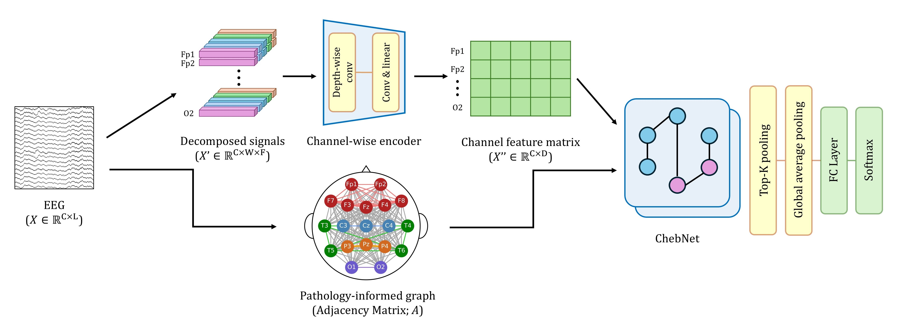
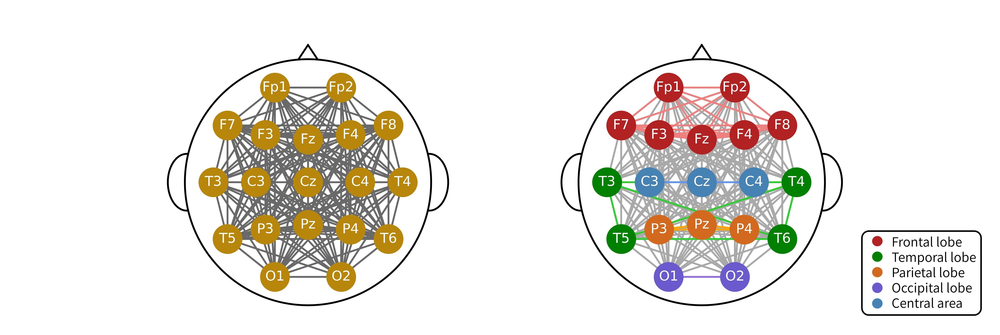
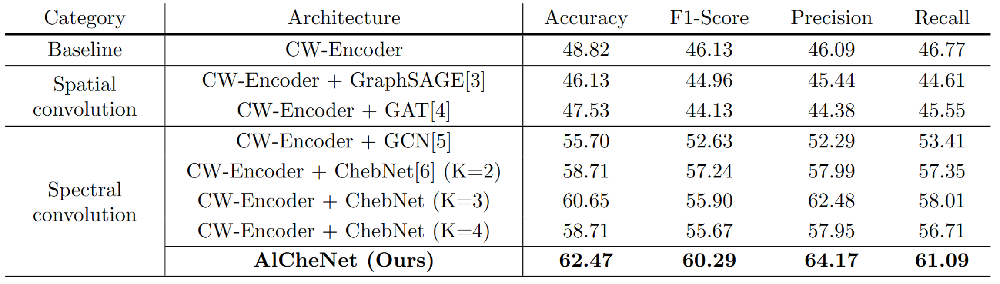

<h1 align="center">AlCheNet</h1>

<p align="center">
  <b>Pathology-informed Graph · Channel-wise Encoder · ChebNet</b>
</p>

<p align="center">
  A graph-based model for EEG analysis combining pathology-informed graph construction,
  channel-wise encoding, and ChebNet.
</p>

<p align="center">
  <a href="#-model-overview">Model Overview</a> ·
  <a href="#-setup">Setup</a> ·
  <a href="#-dataset">Dataset</a> ·
  <a href="#-train--test">Train &amp; Test</a> ·
  <a href="#-results">Results</a> ·
  <a href="https://draw-code-boy.tistory.com/624">Project Retrospective</a>
</p>

---

## 🧠 Model Overview

**AlCheNet** brings together three components:

| Component | Role |
| :--- | :--- |
| **Pathology-informed Graph** | Incorporates pathology information into graph construction. |
| **Channel-wise Encoder** | Encodes EEG channel features. |
| **ChebNet** | Learns graph representations for classification. |

<p align="center">
  
</p>

<p align="center">
  
</p>

## 🛠️ Setup

### Ubuntu setup

#### 1. Create a container

Run these commands on the host. Adjust the container name and shared memory size to suit your environment.

```bash
docker pull ubuntu:22.04
docker run -itd --gpus=all --shm-size=8g --name <container_name> ubuntu:22.04
docker exec -it <container_name> bash
```

#### 2. Install system packages and clone the repository

Run the following commands inside the container.

```bash
apt-get update
apt-get install -y sudo
sudo apt-get install -y git curl unzip python3 python3-venv

git clone https://github.com/drawcodeboy/AlCheNet.git
cd AlCheNet
```

#### 3. Create a Python environment

```bash
python3 -m venv .venv
source .venv/bin/activate
pip install -r requirements.txt
```

## 📁 Dataset

Download the **Open Nuro Dataset** and extract it under `data/` from the repository root.

```bash
mkdir -p data
curl -L -o ./data/open-nuro-dataset.zip https://www.kaggle.com/api/v1/datasets/download/yosftag/open-nuro-dataset
unzip data/open-nuro-dataset.zip -d data/open-nuro-dataset
```

The preprocessing script expects the dataset at `data/open-nuro-dataset/dataset`.

### Data processing

Prepare the **DTW adjacency matrices** and **node features (EEG channel features)** before training.

```bash
python datasets/data2np.py
```

## 🚀 Train & Test

Use a configuration name **without the `.yaml` extension**. Training configurations are in `configs/train/`, and test configurations are in `configs/test/`.

```bash
# Train
python train.py --config=<config_name>

# Test
python test.py --config=<config_name>
```

For AlCheNet:

```bash
python train.py --config=alchenet
python test.py --config=alchenet
```

Before running, review the configuration files:

| Setting | Where to configure |
| :--- | :--- |
| GPU device | Set `device` in both configurations to match your environment; the AlCheNet defaults use `cuda:1`. |
| Dataset path | Check the `root` values in the training and test configurations. |
| Test checkpoint | Set `save_dir` and `weights_file_name` in the test configuration to the checkpoint you want to evaluate. |

## 📊 Results

<p align="center">
  
</p>
